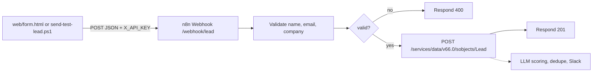

# sales-automation-n8n-ai


Lead intake for a cybersecurity MSSP sales team. A prospect submits a service interest (SOC, MDR, EDR, DLP, Email Security, Pentest, Incident Response). n8n accepts the lead on an authenticated webhook, checks the required fields, and creates a Salesforce Lead through the REST API.

This is the working slice of that pipeline. Scoring, routing, alerts, and the rest of the build guide are listed under Roadmap and are not in the repo yet.

## Architecture



Solid lines are in `workflows/WF-01-intake.json`. The dashed step is roadmap.

## What works today

| Piece | Where | Behavior |
|---|---|---|
| Lead form | `web/form.html` | POSTs JSON to `http://localhost:5678/webhook/lead` with header `X_API_KEY` |
| Intake workflow | `workflows/WF-01-intake.json` | Header Auth, validate, IF on `$json.valid`, 400 or Salesforce create, then 201 |
| CLI test lead | `scripts/cli/send-test-lead.ps1` | Reads `INTAKE_KEY` from the environment or `.env` and sends the same header |
| Salesforce token client | `scripts/salesforce/auth.mts` | OAuth 2.0 client-credentials token fetch, cached in memory |
| Stricter lead check | `scripts/intake/validate.mts` | Same required fields as the workflow, plus zod email format |
| Tests | `tests/` and `.github/workflows/ci.yml` | `node:test` against local mocks. No live Salesforce or n8n |

The workflow Code node checks that `name`, `email`, and `company` are non-empty after trim. It does not check email format. `validate.mts` does, and CI covers it. n8n does not load this package, so a present-but-malformed email still passes the webhook.

A failed Salesforce call does not yet return a formatted error body. The execution fails, and the error-workflow path is roadmap.

## Run it locally

Windows PowerShell. Chain commands with `;`.

```powershell
Copy-Item .env.example .env ; npm ci
```

Fill `.env` before you call Salesforce or the webhook. Names are in `.env.example`. Values stay on your machine.

1. Start n8n: `npx n8n` (UI at `http://localhost:5678`). Current n8n (2.42) needs Node.js 24 or newer. `npm test` runs on Node.js 22 or newer and does not start n8n.
2. Import `workflows/WF-01-intake.json`. It imports inactive.
3. Create a Header Auth credential named `X_API_KEY`. Header name: `X_API_KEY`. Value: the same string as `INTAKE_KEY`.
4. Create an OAuth2 API credential named `Salesforce Client Credentials`. Steps are in [docs/salesforce-setup.md](docs/salesforce-setup.md).
5. Open **Create Salesforce Lead**. Attach that credential and replace `your-org` in the URL with your My Domain host.
6. Attach `X_API_KEY` to the Webhook node if import left it unset. Activate the workflow.
7. If the browser blocks the form, set the Webhook node's Allowed Origins to `*` for local use.

Send a test lead:

```powershell
.\scripts\cli\send-test-lead.ps1
```

The script reads `.env` and does not override variables already set in the session. Or open `web/form.html` and submit it. Change the `API_KEY` placeholder in that file to your local key first.

Check the token client without printing the access token:

```powershell
npm run salesforce:token
```

Run the tests:

```powershell
npm test
```

## Layout

```
workflows/WF-01-intake.json    n8n export
web/form.html                  local intake form
scripts/cli/send-test-lead.ps1 authenticated test POST
scripts/salesforce/auth.mts    client-credentials token fetch
scripts/intake/validate.mts   zod lead check used by tests
tests/                         node:test, mocks only
docs/salesforce-setup.md       External Client App and n8n credential
.env.example                   variable names, empty values
```

## Design decisions

- **Header auth on the webhook.** The intake URL is reachable by anyone who learns it. The Webhook node requires header `X_API_KEY`. With that credential attached, n8n answers 403 when the header is missing or wrong, and the rest of the workflow does not run. With no credential selected, n8n answers 500.
- **Validate before the CRM write.** The IF node sends `$json.valid === false` to **Respond 400** with the error list. Salesforce is only on the true branch.
- **Client Credentials for Salesforce.** This org requires PKCE on the authorization-code flow, and n8n's built-in Salesforce OAuth credential does not support PKCE. The HTTP Request node uses generic OAuth2 Client Credentials against an External Client App, acting as that app's Run As user. The token URL is the My Domain, and the credential sends the client id and secret in the body.
- **Secrets stay out of git.** Webhook key and Salesforce consumer secret live in the n8n credential store and in `.env`. The workflow export names those credentials and does not contain their values. `.env` is gitignored.

## Security

- The committed form key `dev-only-key` is a local placeholder. A page you deploy needs a server-side hold on the real key.
- `scripts/salesforce/auth.mts` prints `instance_url` only.
- The Salesforce host in the workflow is `your-org.my.salesforce.com`. Put the real My Domain on your machine after import.
- CI has no Salesforce, n8n, or LLM credentials. Tests point the token client at `127.0.0.1`.

## Roadmap

- [ ] Reject malformed emails inside the n8n Code node, using the same zod rules as `scripts/intake/validate.mts`
- [ ] Dedupe and idempotent Lead upsert (`External_Lead_Id__c`, SOQL lookup)
- [ ] LLM lead scoring with structured JSON output
- [ ] Slack or email alert for hot leads
- [ ] Error workflow, retries, and a dead-letter replay
- [ ] Playwright API tests against a running n8n (`@playwright/test` is already installed; CI does not start n8n or download browsers)

## After you pull

Your n8n database still has the previous workflow until you re-import.

1. Re-import `workflows/WF-01-intake.json` (same workflow id `fz6i57gKSkm623vw`).
2. Recreate or reattach credential `X_API_KEY` (header name `X_API_KEY`) and credential `Salesforce Client Credentials`.
3. Replace `your-org` in the Lead URL. Activate the workflow.
4. Copy `.env.example` to `.env` if you do not already have one. Set `INTAKE_KEY` to that header value.
5. Point `web/form.html` `API_KEY` at the same value for browser tests, and leave that change uncommitted.
