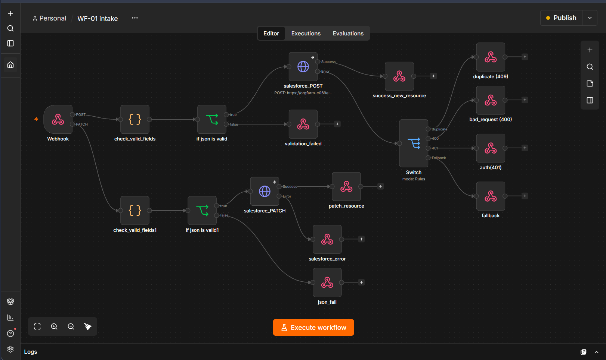
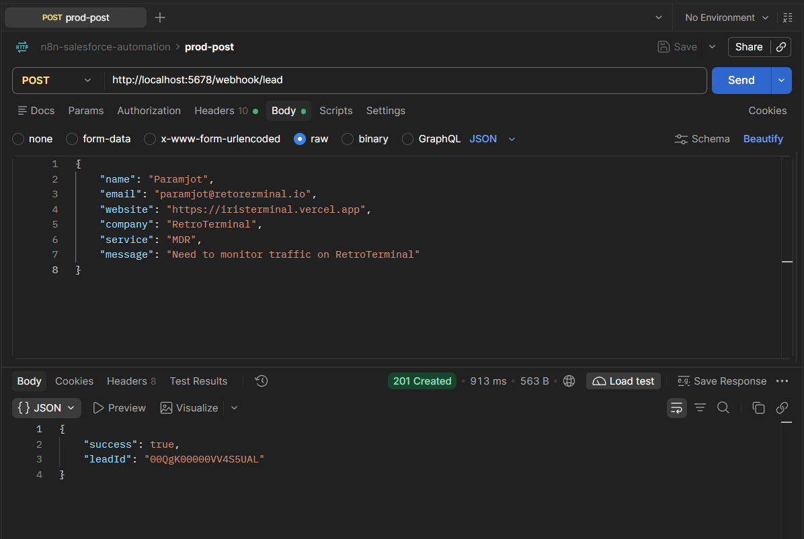
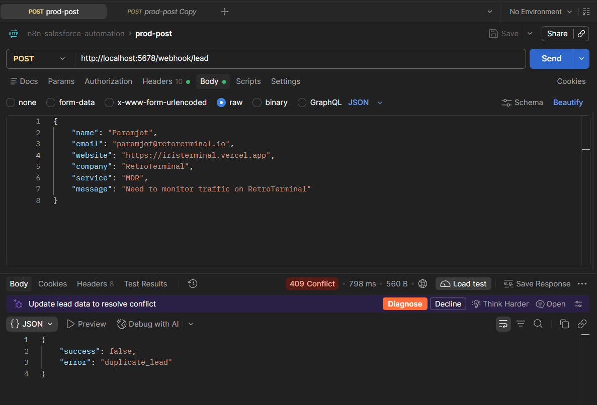
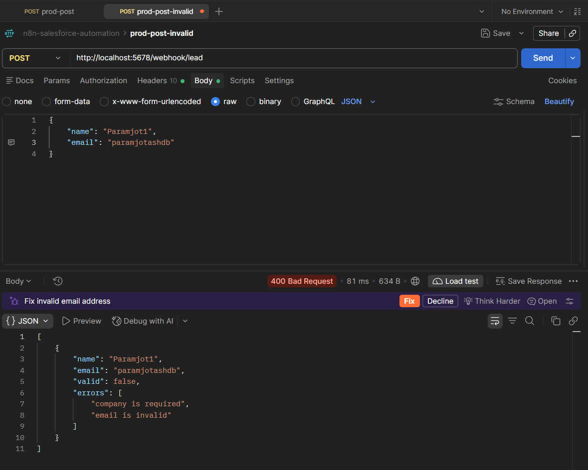
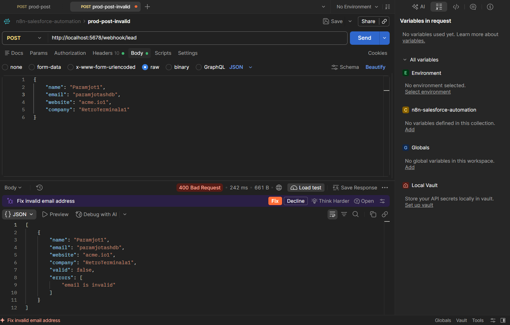
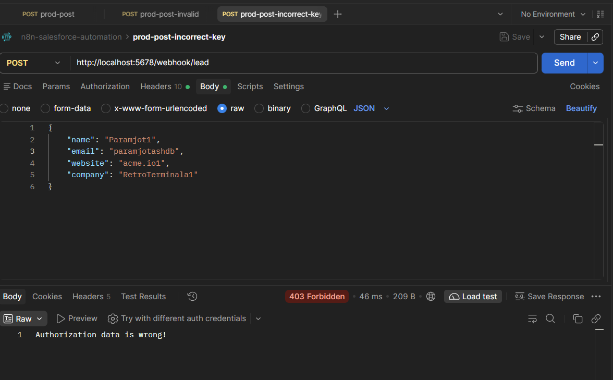
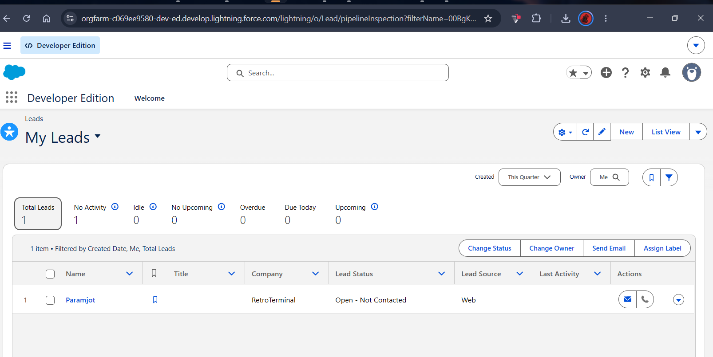
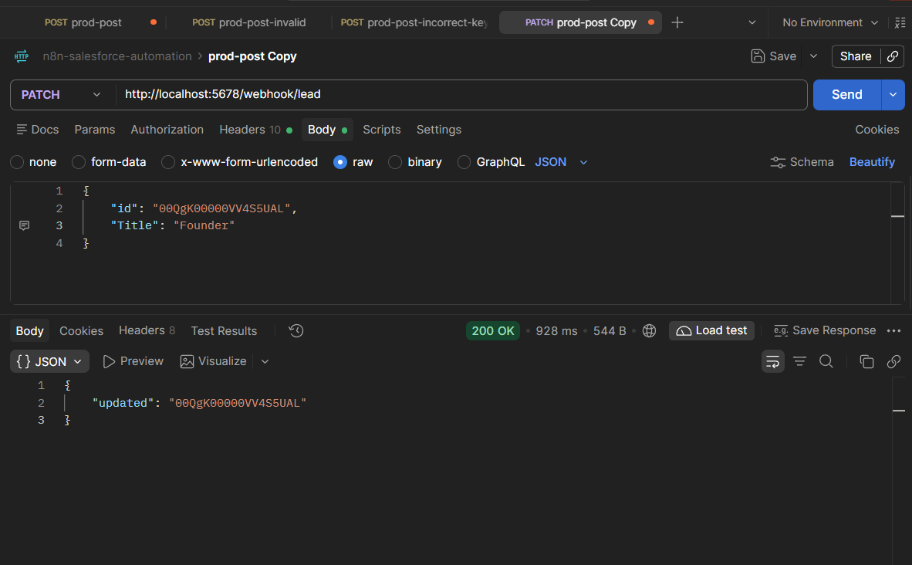
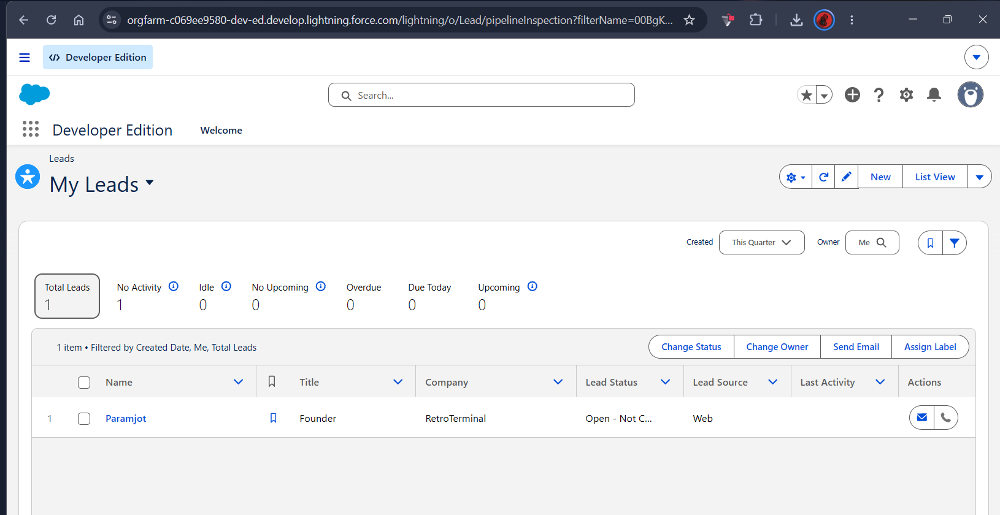
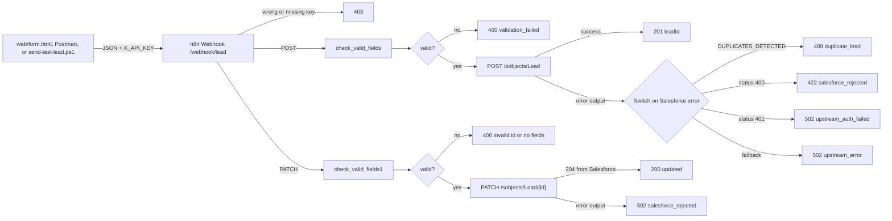

# sales-automation-n8n-ai


Lead intake for a cybersecurity MSSP sales team. A prospect submits a service interest (SOC, MDR, EDR, DLP, Email Security, Pentest, Incident Response). n8n accepts the lead on an authenticated webhook, validates it, creates a Salesforce Lead through the REST API, and maps every Salesforce outcome to a clear HTTP response. The same endpoint also updates existing leads with PATCH.

Verified end to end against a Salesforce Developer Edition org: valid leads are created (201), duplicates are blocked (409), invalid input is rejected before any API call (400), and bad keys are refused (403), and existing leads are updated with PATCH (200).

## Screenshots

### Workflow



### POST (create)

| Case | Screenshot |
|---|---|
| 201 lead created |  |
| 409 duplicate |  |
| 400 missing email |  |
| 400 invalid email |  |
| 403 wrong key |  |

### PATCH (update)

| Case | Screenshot |
|---|---|
| Lead before update |  |
| Update response |  |
| Lead after update |  |

## Architecture



## API responses

### POST /webhook/lead (create)

Body: `{ "name": "...", "email": "...", "company": "...", "website": "...", "service": "...", "notes": "..." }`

| Status | When | Body |
|---|---|---|
| 201 | Lead created in Salesforce | `{ "success": true, "leadId": "00Q..." }` |
| 400 | Missing name, email, or company, or invalid email | `{ "valid": false, "errors": [...] }` |
| 403 | Missing or wrong `X_API_KEY` header | rejected by n8n before the workflow runs |
| 409 | A lead with this email already exists (Salesforce duplicate rule) | `{ "success": false, "error": "duplicate_lead" }` |
| 422 | Malformed JSON (n8n body parser), or Salesforce rejected the data | `{ "success": false, "error": "salesforce_rejected" }` |
| 502 | Salesforce auth failure or any other upstream error | `{ "success": false, "error": "upstream_error" }` |

### PATCH /webhook/lead (update)

Body: `{ "id": "00Q...", "Title": "Founder" }`. Only `Title`, `Phone`, `Company`, and `Status` are updatable; any other field is ignored.

| Status | When | Body |
|---|---|---|
| 200 | Lead updated (Salesforce returns 204 with no body) | `{ "updated": "00Q..." }` |
| 400 | `id` is not a 15 or 18 character Salesforce ID, or no updatable fields were sent | `{ "valid": false, "errors": [...] }` |
| 403 | Missing or wrong `X_API_KEY` header | rejected by n8n before the workflow runs |
| 502 | Salesforce rejected the update (unknown id, bad value, auth) | `{ "success": false, "error": "salesforce_rejected" }` |

4xx means the caller must fix the request. 5xx means the request was fine and the failure is upstream, so it is safe to retry later. Raw Salesforce error details and stack traces are never passed back to the caller.

## What's in the repo

| Piece | Where | Behavior |
|---|---|---|
| Lead form | `web/form.html` | POSTs JSON to `http://localhost:5678/webhook/lead` with header `X_API_KEY` from a password field |
| Intake workflow | `workflows/WF-01-intake.json` | One webhook for POST and PATCH, header auth, validation, Salesforce create and update, Switch-based error mapping, one Respond node per outcome |
| CLI test lead | `scripts/cli/send-test-lead.ps1` | Reads `INTAKE_KEY` from the environment or `.env` and sends the same header |
| Salesforce token client | `scripts/salesforce/auth.mts` | OAuth 2.0 client-credentials token fetch, cached in memory |
| Lead validation | `scripts/intake/validate.mts` and the workflow Code node | Required fields plus an email format check; email is trimmed and lowercased |
| Tests | `tests/` and `.github/workflows/ci.yml` | `node:test` unit tests against local mocks, plus contract tests that check the exported workflow's routing, status codes, PATCH allow-list, and that it ships inactive with no org host. No live Salesforce or n8n |

## Run it locally

Windows PowerShell. Chain commands with `;`.

```powershell
Copy-Item .env.example .env ; npm ci
```

Fill `.env` before you call Salesforce or the webhook. Names are in `.env.example`. Values stay on your machine.

1. Start n8n: `npx n8n` (UI at `http://localhost:5678`). Current n8n needs Node.js 24 or newer. `npm test` runs on Node.js 22 or newer and does not start n8n.
2. Import `workflows/WF-01-intake.json`. It imports inactive.
3. Create a Header Auth credential named `X_API_KEY`. Header name: `X_API_KEY`. Value: the same string as `INTAKE_KEY`.
4. Create a generic **OAuth2 API** credential with grant type **Client Credentials**. Steps are in [docs/salesforce-setup.md](docs/salesforce-setup.md).
5. Open both HTTP Request nodes (`salesforce_POST` and `salesforce_PATCH`), attach that credential, and replace `your-org` in each URL with your My Domain host.
6. Attach `X_API_KEY` to the Webhook node if import left it unset, then publish or activate the workflow.

Send a test lead:

```powershell
.\scripts\cli\send-test-lead.ps1
```

Update a lead:

```powershell
$h = @{ "X_API_KEY" = $env:INTAKE_KEY } ; Invoke-RestMethod -Method Patch -Uri http://localhost:5678/webhook/lead -Headers $h -ContentType "application/json" -Body '{"id":"00Q...","Title":"Founder"}'
```

Run the tests:

```powershell
npm test
```

## Design decisions

- **Header auth on the webhook.** The intake URL is reachable by anyone who learns it, so the Webhook node requires `X_API_KEY`. A missing or wrong key gets 403 and nothing else runs.
- **Validate at the edge.** Bad input is rejected with 400 before it costs a Salesforce API call. Salesforce validation stays as a safety net.
- **Switch for error mapping.** The HTTP Request node uses its error output. A Switch maps Salesforce failures to caller-facing codes. The duplicate rule is checked first because Salesforce reports duplicates as a generic 400. Adding a new error case is one more rule.
- **One webhook, two methods.** POST creates and PATCH updates on the same `/lead` path, and n8n routes each method to its own branch. PATCH carries the lead id in the body.
- **Allow-list on PATCH.** Only `Title`, `Phone`, `Company`, and `Status` are forwarded, so a caller cannot change owner, status history, or any field the API never meant to expose. PATCH changes only the fields sent; Salesforce does not support PUT on sObjects.
- **Contract tests on the export.** The workflow JSON is the source of truth for the API, so tests fail CI if a node, route, or status code drifts.
- **Client Credentials for Salesforce.** The org requires PKCE on the authorization-code flow, which n8n's built-in Salesforce credential does not support. The workflow uses generic OAuth2 Client Credentials against an External Client App with a Run As user and the `api` scope. The token URL is the My Domain host.
- **Secrets stay out of git.** The webhook key and Salesforce consumer secret live in the n8n credential store and in `.env`. The workflow export names credentials without their values. `.env` is gitignored.

## Security

- The committed form contains no key. A deployed form should keep the key on the server.
- `scripts/salesforce/auth.mts` prints `instance_url` only, never the token.
- The Salesforce host in the committed workflow is a placeholder.
- CI has no Salesforce, n8n, or LLM credentials.